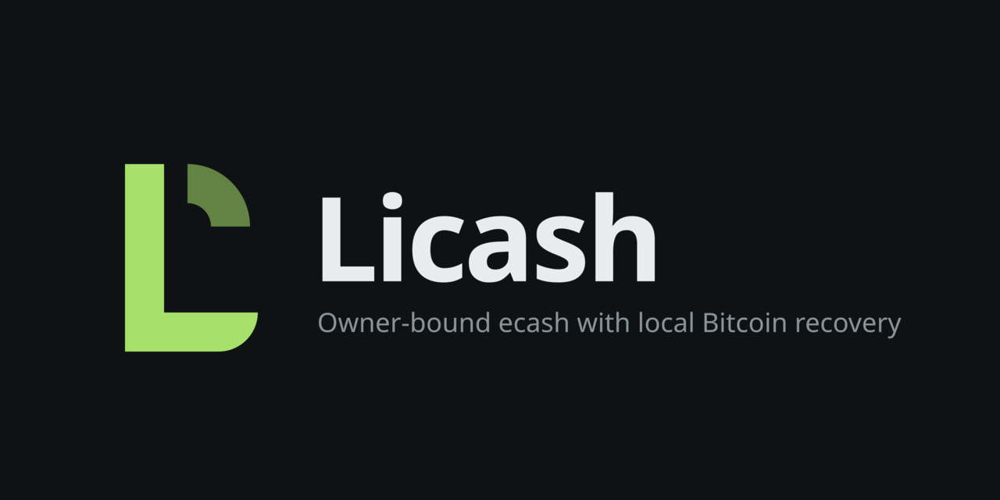

# Licash



**A private Bitcoin checking account that you can always take back on
Bitcoin.**

Licash is ecash with an exit. A hub issues notes that you pay with
instantly, privately and almost for free. Unlike ordinary ecash, you hold an
individual Bitcoin contract with the hub. It lets you recover your notes on
Bitcoin without the hub's cooperation, up to a limit you choose, like
insurance. You never prove anything to recover: the hub must prove,
with a payment you signed, that you are owed less.

It is not meant for your savings. Keep those in cold storage, and use Licash
for day-to-day spending, as a checking account.

## Why

- **No consolidation, no toxic change.** Each coin you receive is swapped in
  on its own, and you pay out onchain exactly the amount you need. Your
  coins never get spent together, so they can't be clustered.
- **Lightning without a node.** Pay and receive over Lightning with no
  channels, no inbound liquidity and no watchtower.
- **Private payments.** The hub cannot link a note's spending to its
  issuance, and payments leave nothing on Bitcoin.
- **Receive while offline.** Within a hub, a payer can pay you while your
  phone is off.
- **Fast and cheap.** Payments within a hub are instant and use no
  blockspace.
- **You keep custody, up to your limit.** Value within your contracts can
  always be recovered on Bitcoin. A stale backup is paid exactly what is
  still unspent, never punished.

The [paper](paper/licash.pdf) describes the protocol, its security and its
privacy.

## Try it

Licash runs on signet and Mutinynet. Contracts there are a trial: the
code has not had a security review, so do not use real funds. The signets'
headers are checked by their work alone, not by the network's signature of
each block, so headers that fool a contract's statement cost little to make,
and a contract's recovery there is only as strong as that work.

- **Android:** install `licash-main.apk` from the
  [`main-build` release](https://github.com/lichenbtc-org/licash/releases/tag/main-build),
  turn on advanced mode, pick signet and choose a hub announced on Nostr.
- **Command line:**

  ```sh
  docker run --rm -it -v licash:/data ghcr.io/lichenbtc-org/licash-wallet init --network signet
  docker run --rm -it -v licash:/data ghcr.io/lichenbtc-org/licash-wallet \
    discover --relay wss://relay.primal.net
  docker run --rm -it -v licash:/data ghcr.io/lichenbtc-org/licash-wallet add-hub <URL>
  ```

  See [apps/wallet-cli](apps/wallet-cli/README.md) for receiving and paying.
- **Everything locally**, with Docker: `apps/e2e/run.sh` brings up a regtest
  network with hubs, a Lightning gateway, swap providers and wallets, and
  runs the end-to-end tests against it.

## Components

[Wallet CLI](apps/wallet-cli/README.md) ·
[Android app](apps/mobile/android/README.md) ·
[Hub](apps/hub/README.md) ·
[Swap provider](apps/swaps/README.md) ·
[Proving](r0/README.md) ·
[Contracts on regtest](regtest/README.md)

To build and test the library, run `cargo test --locked`. For the
applications, run `cargo test --locked --manifest-path apps/Cargo.toml`.

## License

MIT, see [LICENSE](LICENSE).
